# Browsing Without Buying

**E-commerce conversion analytics · statistical evidence · session-level classification**

**Project author:** Cyril James Lunzaga

## Executive summary

Why do some recorded shopping sessions end in a purchase while others do not? This project uses reproducible descriptive analysis, uncertainty estimates, statistical tests, and machine-learning comparisons to examine the recorded sessions. It distinguishes **observed relationships** from **predictive classification performance** and from interventions that the data cannot support.

| Key metric | Observed value |
| --- | ---: |
| Recorded sessions | **12,330** |
| Purchasing sessions | **1,908** |
| Non-purchasing sessions | **10,422** |
| Observed session conversion | **15.47%** |
| Source attributes | **18** (17 inputs + Revenue) |
| Missing cells | **0** |
| Exact-match later rows, retained | **125** |

## Project objectives

1. Audit the original dataset and quantify data-quality and duplicate-record sensitivity.
2. Compare conversion across visitor type, browsing depth, traffic sources, browser and regional categories, and other recorded session attributes.
3. Evaluate the strength and uncertainty of exploratory associations using effect sizes, intervals, and multiple-testing control.
4. Compare a prior-only baseline, logistic regression, and random forest using a group-isolated holdout and training-only hyperparameter selection.
5. Turn the evidence into practical hypotheses for **future testing**, without inventing customer journeys, cart abandonment, revenue or causal effects.

## Dataset and analytical scope

- **Source:** [UCI Online Shoppers Purchasing Intention Dataset](https://archive.ics.uci.edu/dataset/468/online+shoppers+purchasing+intention+dataset), Sakar & Kastro (2018), DOI [10.24432/C5F88Q](https://doi.org/10.24432/C5F88Q); license **CC BY 4.0**.
- **Unit:** recorded shopping session; `Revenue` is a binary indicator that the recorded session ended in a purchase.
- **Input:** 18 CSV columns. Categorical integer codes are treated as labels, not ordinal magnitudes.
- **Integrity:** original records are retained. Excluding later exact-match rows changes overall conversion by **+0.158 percentage points**, but matching features do not establish duplicate events.
- **Leakage boundary:** `PageValues` is excluded from principal models and explanatory results because its definition is transaction-linked. A separate sensitivity experiment documents the difference.
- **Data ownership:** the raw CSV stays under `data/raw/` locally and is never committed to Git.

## Findings from exploratory analysis

**Visitor category.** Recorded New_Visitor sessions converted at **24.91%** (422/1,694), versus **13.93%** (1,470/10,551) for Returning_Visitor sessions, a **+10.98 percentage-point** descriptive difference. A 2,000-replicate session bootstrap produced an exploratory 95% interval of **+8.81 to +13.16 percentage points**.

**Statistical associations.** The largest Cramér's V in the prespecified categorical test family was **page_depth** (**0.186**); the largest absolute numeric rank-biserial effect was **ExitRates** (**-0.406**). The original eight tests use Benjamini–Hochberg adjustment. These comparisons do not prove causes.

**Additional segmentation.** The upgrade adds region, browser, operating-system and special-day breakdowns, Wilson intervals for categorical conversion estimates, and composition plots. Groups with fewer than 100 records remain in CSV evidence but are flagged as sparse; interval charts emphasize adequately sized groups. Codes lack published business labels and should not be translated into invented audience profiles.

### Additional quantified patterns

**Browsing depth.** Sessions with 21+ product pages had observed purchase completion of **21.96%** (1,229/5,597), versus **4.12%** (96/2,331) for 1–5 pages. This is a full-session association, not proof that increasing page views creates purchases. See the [depth table](outputs/advanced_segmentation/tables/conversion_by_product_depth.csv).

**Weekend label.** Weekend sessions converted at **17.40%** (499/2,868) versus **14.89%** (1,409/9,462) on weekdays. This comparison is unadjusted for traffic mix and month; it is not a causal weekend effect. See the [weekend table](outputs/advanced_segmentation/tables/conversion_by_weekend.csv).

**SpecialDay indicator.** Sessions with nonzero SpecialDay proximity converted at **6.16%** (77/1,251) versus **16.53%** (1,831/11,079) for zero proximity. SpecialDay is a source-defined proximity feature, not a verified calendar event or promotion indicator. See the [SpecialDay table](outputs/advanced_segmentation/tables/conversion_by_special_day.csv).

### Session composition and conversion

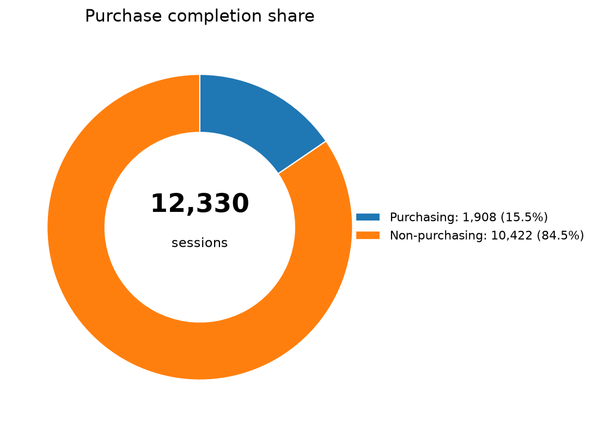

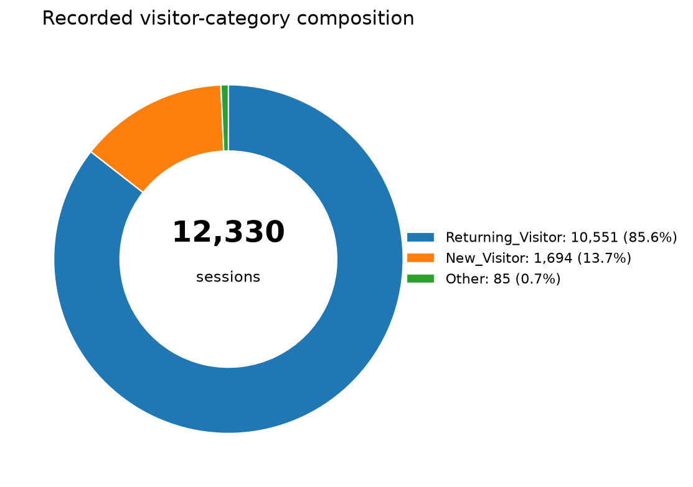

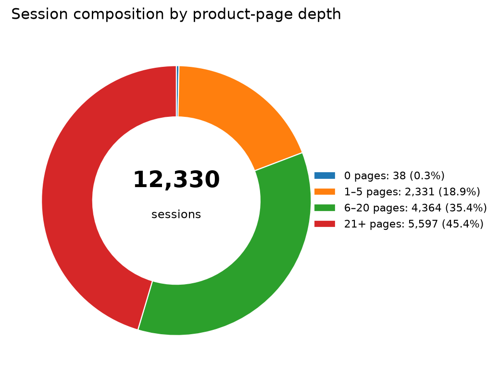

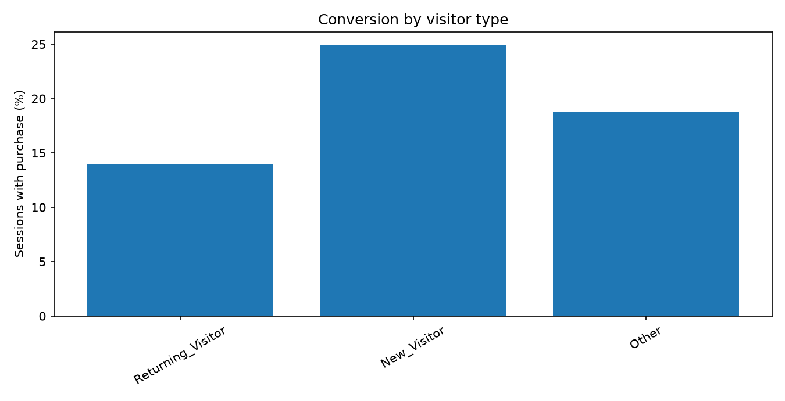

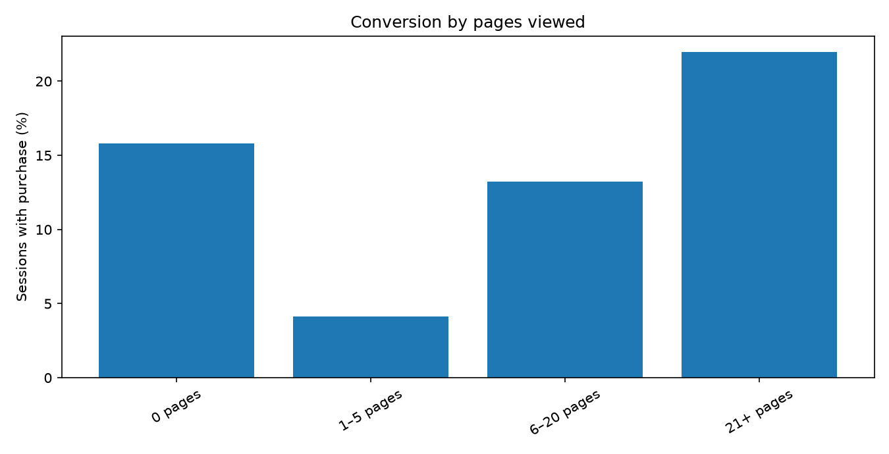

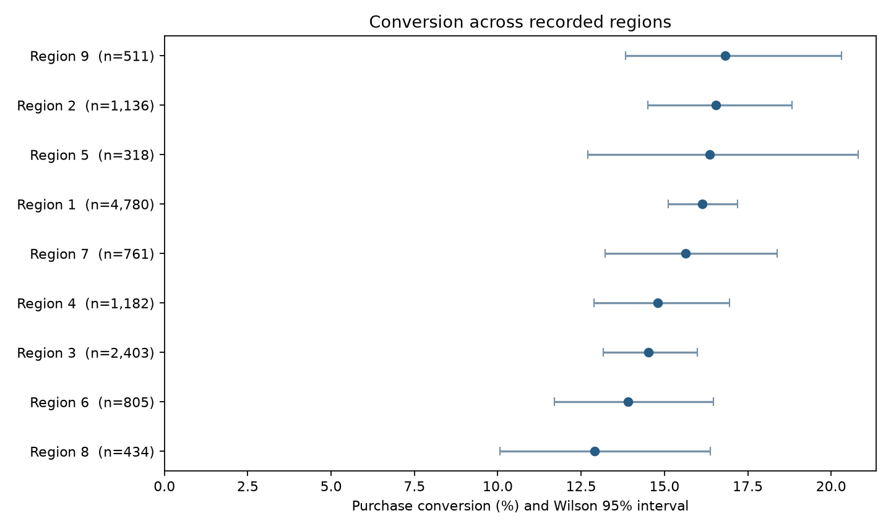

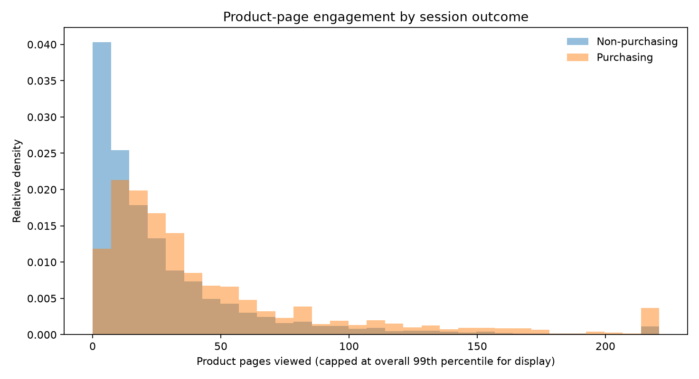

For the full collection, see [visitor–depth heatmap](outputs/deep_dive/charts/visitor_depth_heatmap.png), [bounce-rate bands](outputs/deep_dive/charts/conversion_by_bounce_band.png), [traffic-type chart](outputs/deep_dive/charts/high_volume_traffic_codes.png), [month comparison](outputs/charts/conversion_by_month.png), and [browser intervals](outputs/advanced_segmentation/charts/browser_intervals.png).

## Predictive algorithms and tuning

The model selected using **training-only cross-validation** was **Random forest** (mean CV average precision **0.389**). On the **2,466-session held-out group split**, average precision was **0.361**, compared with **0.155** for the prior-only baseline; ROC-AUC was **0.771**. This is retrospective session classification, not a deployed or time-forward validated forecasting system.

| Model | Test average precision | ROC-AUC | Precision @0.50 | Recall @0.50 | Brier |
| --- | ---: | ---: | ---: | ---: | ---: |
| Majority-prior baseline | 0.155 | 0.500 | 0.000 | 0.000 | 0.131 |
| Logistic regression | 0.323 | 0.741 | 0.636 | 0.037 | 0.119 |
| Random forest | 0.361 | 0.771 | 0.594 | 0.050 | 0.115 |

At the fixed **0.50** decision threshold, the CV-selected model's held-out recall is **5.0%**. This is a crucial operational limitation: good ranking performance need not translate into strong recall at a default cutoff. A separate decision threshold of **0.225**, selected by training-only out-of-fold F1 (not test performance), yields held-out precision **0.332**, recall **0.592**, and F1 **0.425**. These policies are compared in the [threshold evaluation table](outputs/modeling/tables/threshold_sensitivity.csv). Threshold tuning changes the precision–recall trade-off, not the underlying ranking quality or deployment readiness. **Average precision**, supported by ROC-AUC, confusion matrices and Brier score, is emphasized because only about 15.5% of sessions are purchases.

**Model design:** nominal category one-hot encoding and numeric standardization in a scikit-learn pipeline; exact matching input profiles assigned to the same partition; approximately one fifth held out via five-fold stratified group splitting; three-fold group-aware cross-validation on the training portion; a small, documented hyperparameter grid for logistic regression and random forest. The model family is selected using **training CV scores**, not held-out metrics. The selected model's held-out average precision has a 400-replicate, class-stratified bootstrap interval of **0.320–0.401**, conditional on session-level independence.

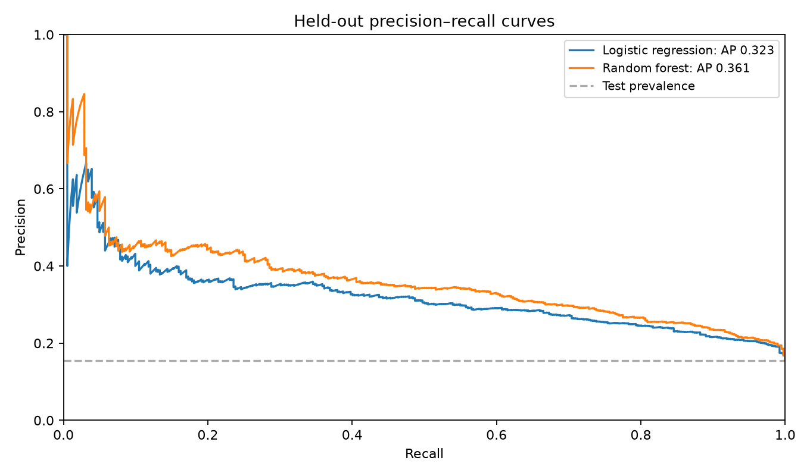

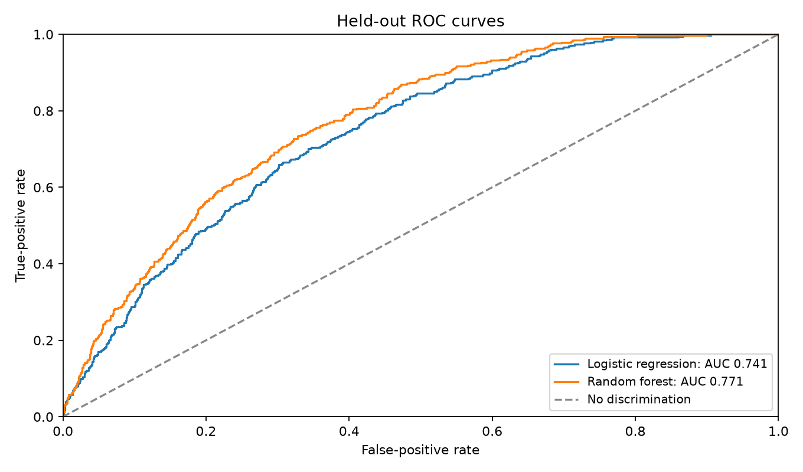

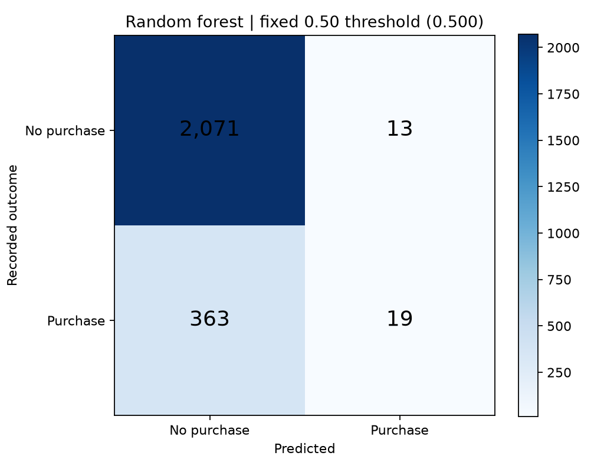

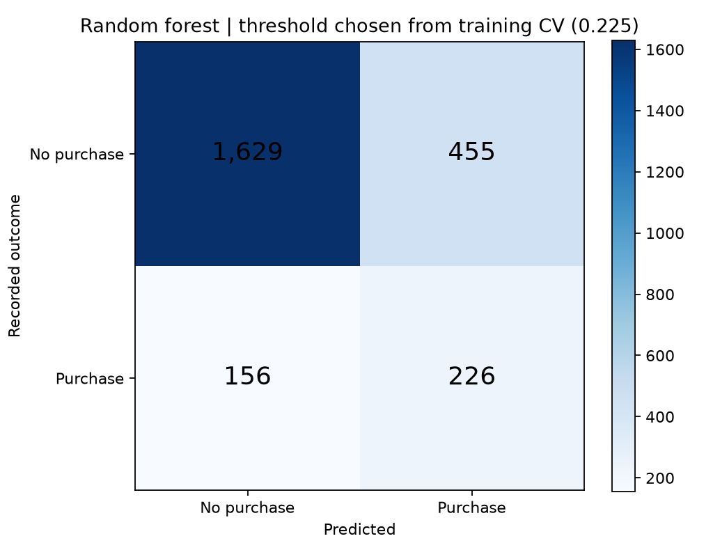

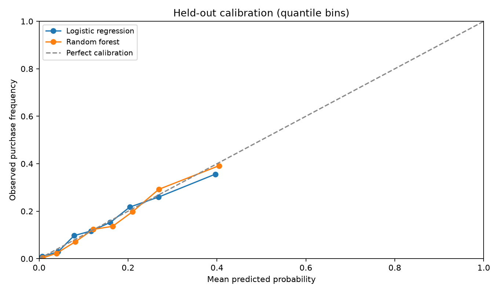

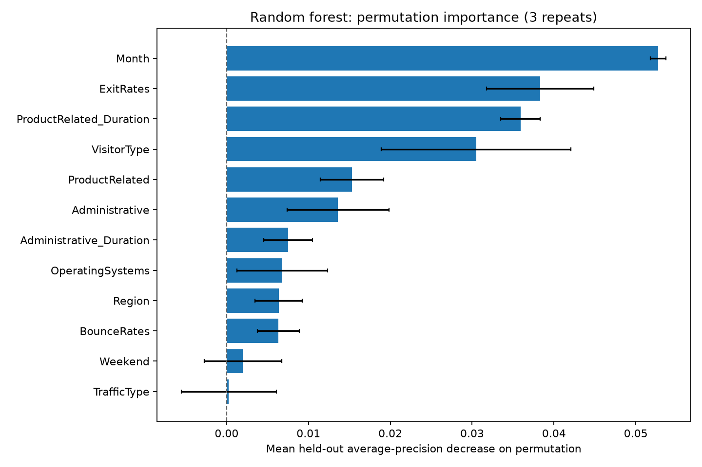

Read the [model evaluation](outputs/modeling/model_report.md), [model comparison table](outputs/modeling/tables/model_comparison.csv), [training CV tuning table](outputs/modeling/tables/cross_validation_tuning.csv), [permutation importance](outputs/modeling/tables/permutation_importance.csv), and [transaction-linked PageValues sensitivity](outputs/modeling/tables/pagevalues_sensitivity.csv).

## Execution and technical processing

The pipeline reads the original source CSV, validates its shape and labels, retains all source records, generates descriptive summaries, computes statistical evidence, creates advanced segmentation figures, trains and evaluates classifiers, then builds the README and consolidated case-study report **using the actual numerical outputs**.

```text
source CSV (local, ignored by Git)
    → audit + original descriptive analysis + statistical evidence
    → advanced categorical segmentation + uncertainty plots
    → group-isolated train/test modeling + train-only CV tuning
    → analytical reports + README + reproducibility verification
```

**Run on Windows PowerShell** from the repository root:

```powershell
py -m venv .venv
.\.venv\Scripts\python.exe -m pip install -r requirements.txt
.\.venv\Scripts\python.exe -m scripts.run_upgrade --verify
```

The last command reruns the existing and upgraded pipeline, validates and executes five notebooks, runs the automated test suite, and checks that reports and figures were produced. The notebook executor does not save execution outputs back into the tracked notebooks. For Linux/macOS, use the matching virtual-environment Python interpreter. For manual execution, inspect [the reproducibility and modeling guide](docs/advanced_methodology.md).

**Notebooks:** [01 Source quality](notebooks/01_data_audit.ipynb) · [02 Browsing patterns](notebooks/02_browsing_patterns.ipynb) · [03 Statistical evidence](notebooks/03_statistical_evidence.ipynb) · [04 Segment uncertainty](notebooks/04_advanced_segmentation.ipynb) · [05 Modeling assessment](notebooks/05_predictive_modeling.ipynb).

## Implications, limitations and conclusion

- Segments with reproducible descriptive differences can motivate **A/B-test hypotheses**, usability reviews, or more precise event-data collection. No intervention has been tested here.
- Model evaluation is **retrospective full-session discrimination**. Product-page totals and durations reflect behavior observed across the session, so this is **not** a proven pre-session or real-time purchase predictor.
- User identities, raw event sequences, cart events, exact timestamps, transaction amounts, and an external validation site are absent; customer retention, cart abandonment, revenue loss and causal ROI cannot be estimated.
- The source's one-session-per-user design is reported by UCI but cannot be independently confirmed from the supplied CSV. Random group splitting prevents identical measured input profiles crossing the holdout, not unobserved customer or temporal dependence.
- Month labels are incomplete as a calendar series, and small categorical groups can show unstable estimates. No customer-targeting policy should be built from these observational segments.

**Conclusion:** The dataset supports a rigorous description of purchase-completion patterns and a reproducible internal classification benchmark. Its limitations prevent confident intervention or real-world deployment claims. Stronger next-stage evidence would require timestamped events, identified consented cohorts, a defined decision point, forward-time validation, and randomized experiments.

## Evidence, methods and credits

- [Full advanced case study](outputs/advanced_case_study.md)
- [Original case study](outputs/portfolio_case_study.md)
- [Data audit](outputs/audit/data_audit.md) · [Original statistical review](outputs/statistical_review/statistical_summary.md) · [Segmentation summary](outputs/advanced_segmentation/summary.md)
- [Original conversion methodology](docs/conversion_methodology.md) · [Statistical methods](docs/statistical_methods.md) · [Modeling and reproducibility](docs/advanced_methodology.md)
- **Author:** Cyril James Lunzaga
- **Dataset:** Sakar, C. & Kastro, Y. (2018), [UCI Online Shoppers Purchasing Intention Dataset](https://archive.ics.uci.edu/dataset/468/online+shoppers+purchasing+intention+dataset), CC BY 4.0. Code and analytical interpretation are independent of the dataset authors.
