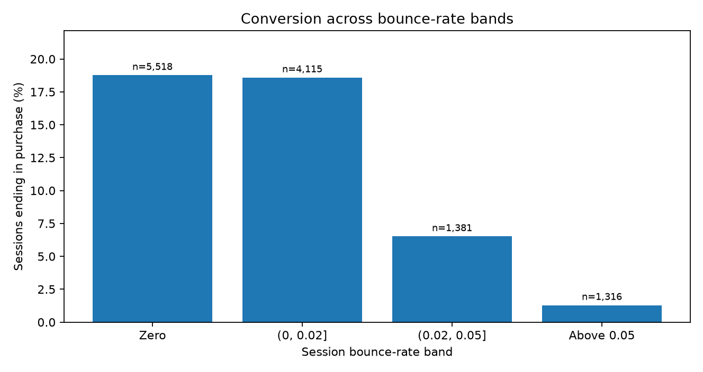

# Browsing Without Buying

**E-commerce conversion analytics | Descriptive analysis and statistical review**

**Project owner:** Cyril James Lunzaga

This project examines how recorded online shopping sessions differ between sessions that end in a purchase and those that do not. It combines a documented source audit, visitor and browsing segmentation, reproducible Python analyses, exploratory statistical tests, and a concise analytical case study.

> **Scope:** These are **session-level observational associations**, not identified-customer conversion behavior, confirmed cart abandonment, or causal evidence about what makes shoppers purchase.

## At a glance

| Measure | Observed result |
| --- | ---: |
| Recorded sessions | 12,330 |
| Sessions ending in purchase | 1,908 |
| Overall session conversion | 15.47% |
| Missing values | 0 |
| Subsequent exact-match rows retained | 125 |

## Research questions

1. How often do recorded sessions end in a purchase?
2. How does observed conversion vary across visitor types, browsing-depth groups, and traffic codes?
3. How do browsing engagement and exit-related metrics differ between purchasing and non-purchasing sessions?
4. Which exploratory associations show notable effect sizes, and what are their statistical limitations?

## Key findings

**Visitor categories differ.** New-visitor sessions converted at **24.91%** (422/1,694), compared with **13.93%** (1,470/10,551) for returning-visitor sessions. The observed difference is **+10.98 percentage points**. A fixed-seed, session-level bootstrap produced an exploratory 95% interval of **+8.81 to +13.16 percentage points**; it assumes session independence, which cannot be independently verified from the released CSV.

**Purchasing sessions show more product-page engagement.** Median product pages were **29** for purchasing sessions versus **16** for non-purchasing sessions. Within the 21+ product-page group, observed conversion was **35.04%** for new-visitor sessions (178/508) and **20.55%** for returning-visitor sessions (1,043/5,075). Visiting more pages should not be interpreted as causing purchases.

**Associations vary in magnitude.** Among four tested categorical comparisons, page-depth groups had the largest Cramér's V (**0.186**). Among four numeric comparisons, `ExitRates` had the largest absolute rank-biserial effect size (**−0.406**). Eight exploratory tests were adjusted together using Benjamini–Hochberg. Small p-values are not substitutes for effect sizes, adequate subgroup counts, or a causal study design.

## Selected visualizations




Additional reviewed figures: [visitor × depth heatmap](outputs/deep_dive/charts/visitor_depth_heatmap.png), [high-volume traffic-type codes](outputs/deep_dive/charts/high_volume_traffic_codes.png), and [observed month labels](outputs/charts/conversion_by_month.png). The 0-page depth group has only **38 sessions**, and the `Other` visitor group has **85**; those bars should not be treated as stable estimates. Month-group sample sizes vary, traffic codes have no inherent numeric ranking, and month labels do not form a complete annual time series.

## Evidence and analytical decisions

The original 12,330 source rows are retained. **125 subsequent exact-match rows** were identified, but matching measured fields do not prove repeated data capture or duplicate sessions. Removing those rows as a sensitivity analysis changes overall conversion by **+0.158 percentage points**; deduplication is not applied to primary estimates.

`PageValues` is excluded from explanatory comparisons because its definition is linked to transaction-related value. Small subgroups (fewer than 100 sessions) are flagged. Bins for browsing depth and bounce rate are descriptive choices, not validated risk thresholds. Chi-square expected-cell diagnostics, adjusted p-values, nonparametric effect sizes, and the exploratory visitor-gap interval are documented in the statistical outputs.

Read the full [analytical case study](outputs/portfolio_case_study.md), [data audit](outputs/audit/data_audit.md), [segmentation findings](outputs/deep_dive/summary.md), and [statistical review](outputs/statistical_review/statistical_summary.md). Additional methods are documented in [conversion methodology](docs/conversion_methodology.md) and [statistical methods](docs/statistical_methods.md).

## Reproduce the analysis

1. Download the **UCI Online Shoppers Purchasing Intention Dataset** from the [official UCI repository](https://archive.ics.uci.edu/dataset/468/online+shoppers+purchasing+intention+dataset).
2. Place its CSV at `data/raw/online_shoppers_intention.csv`. The raw dataset is intentionally **not committed** to this repository.
3. Open this repository's root directory in VS Code or a terminal. Set up and install the Python dependencies:

   ```powershell
   py -m venv .venv
   .\.venv\Scripts\python.exe -m pip install -r requirements.txt
   ```

4. Execute the analysis scripts **from the repository root**, in order:

   ```powershell
   .\.venv\Scripts\python.exe scripts/audit_sessions.py
   .\.venv\Scripts\python.exe analysis.py
   .\.venv\Scripts\python.exe scripts/conversion_deep_dive.py
   .\.venv\Scripts\python.exe scripts/statistical_review.py
   .\.venv\Scripts\python.exe scripts/build_portfolio_report.py
   .\.venv\Scripts\python.exe -m pytest -q --basetemp=.venv/pytest-tmp
   ```

5. Inspect outputs in `outputs/`. The three notebooks in `notebooks/` provide a complementary, readable walkthrough; select the `.venv` Python kernel and execute them with the working directory set to the repository root.

The test command specifies a project-local temporary directory to avoid an observed Windows permission issue with the default system temporary folder. The original audit records the source SHA-256 for verification. On macOS/Linux, use the matching `.venv/bin/python` executable instead.

## Limits and responsible interpretation

- UCI states that the dataset was assembled with **one session per user** during its sampled period. However, the released CSV provides no user identifiers to independently verify this design; results are reported at session level.
- The data has no cart-event history or identified customer trajectories, so **cart abandonment** cannot be directly measured.
- Observed engagement, bounce, exit, visitor, and traffic differences are **associations**, not causal purchase drivers.
- Month labels do not support year-over-year conclusions or a complete seasonal analysis.
- The data does not provide a defensible basis for individualized targeting, estimated revenue impact, or experimental effectiveness claims.

**Dataset source and attribution:** Sakar and Kastro (2018), *Online Shoppers Purchasing Intention Dataset*, UCI Machine Learning Repository. Dataset terms are identified as **CC BY 4.0** in the source audit; data are not redistributed here. For the definitive source description, access the [UCI dataset page](https://archive.ics.uci.edu/dataset/468/online+shoppers+purchasing+intention+dataset).
