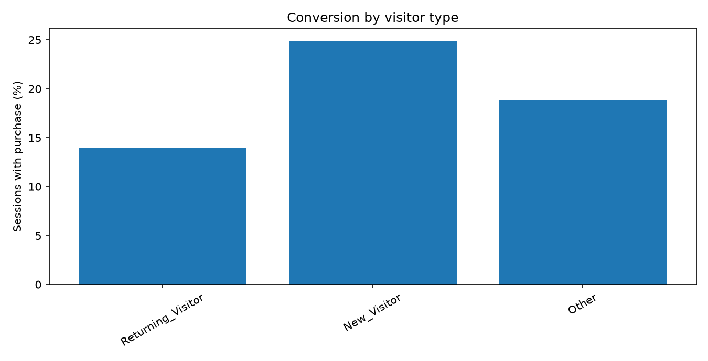
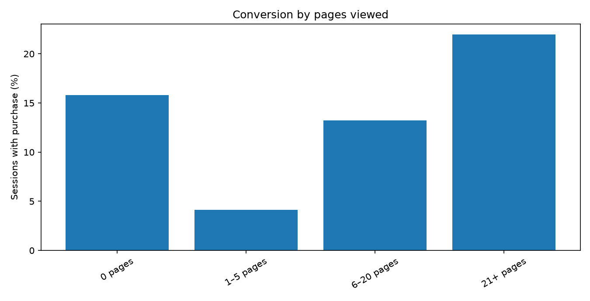
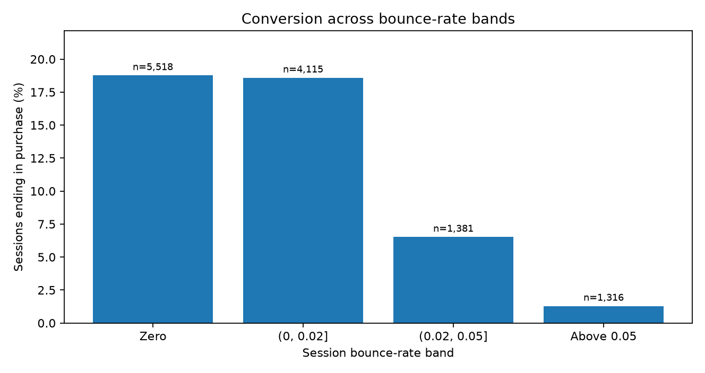

# Browsing Without Buying — Analytical Case Study

**Project owner:** Cyril James Lunzaga

## Objective

Understand how recorded online shopping sessions differ by purchase outcome, visitor category, browsing activity, and traffic characteristics. These findings are observational, not conversion drivers or customer-level predictions.

## Dataset and preparation

- **12,330 sessions**, 1,908 ending in a purchase (**15.47%** conversion).
- **0** missing source cells; **125** later exact-match rows retained.
- Removing the later exact-match rows changes the overall conversion rate by **+0.158 percentage points**.
- UCI describes one session per user, but the CSV has no user IDs to verify the design independently. Exact-match rows are not assumed to be duplicate events, and month labels do not establish a complete time series.

## Main findings

### Visitor category

- New visitors: **24.91%** (422 / 1,694).
- Returning visitors: **13.93%** (1,470 / 10,551).
- Observed gap: **+10.98 percentage points** (new minus returning).
- Exploratory session-level 95% bootstrap interval for the gap: **8.81 to 13.16 percentage points**.

### Browsing engagement

- Median product pages: **29** for purchasing sessions vs **16** for non-purchasing sessions.
- New Visitor visiting 21+ product pages: **35.04%** (178 / 508 sessions).
- Returning Visitor visiting 21+ product pages: **20.55%** (1,043 / 5,075 sessions).

### Statistical context

- Largest tested categorical association: **page_depth**, Cramér's V = **0.186**.
- Largest absolute tested numeric rank-biserial effect: **ExitRates**, r = **-0.406**.
- Eight exploratory p-values were adjusted together with Benjamini–Hochberg; effect sizes and group counts matter more than significance alone.

## Selected visual evidence

## Evidence and limitations

- [Data audit](audit/data_audit.md)
- [Detailed conversion comparison](deep_dive/summary.md)
- [Statistical review](statistical_review/statistical_summary.md)
- `PageValues` is not treated as an independent driver because it is linked to transaction-related page values.
- The CSV has no user IDs to verify UCI's one-session-per-user design; independence-based inferential statistics and bootstrap intervals warrant caution.
- No cart-event history, customer-level identity, sales amounts, or experimental exposure is available; these results cannot establish abandonment, revenue impact, causal effects, or individualized recommendations.

**Source:** UCI Online Shoppers Purchasing Intention Dataset (Sakar & Kastro, 2018; CC BY 4.0). https://archive.ics.uci.edu/dataset/468/online+shoppers+purchasing+intention+dataset
